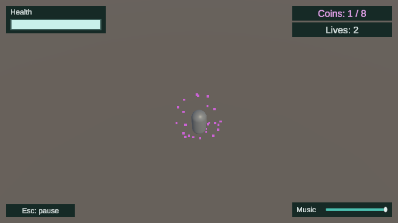
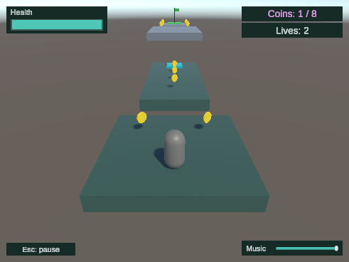
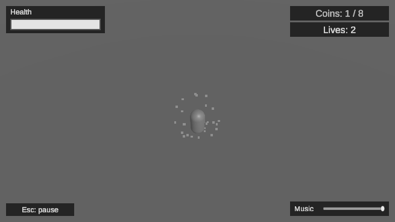

# CS464 Assignment 04 · Muhammad Sarmad Ahmad · BSSE23013

**Video (90–180 s):** https://drive.google.com/file/d/1IFLzIh4hg2aTPcACta-XkU_-5SaV0zwV/view?usp=sharing

Started from my Assignment 03 project (five levels), with MainMenu at index 0, Level01–Level05 at 1 to 5 and Credits at 6.

## Settings

| Part | Setting | Value | Why |
|---|---|---|---|
| A | Harmony · base hue | triadic · 172° (teal) | Teal for the UI, a pink for the score and a yellow for pickups sit a third of the wheel apart. |
| A | Dark · mid · light | #162926 · #50C7B7 · #E9F7F5 | The panel is dark, the button is the mid value and the light value is the highlighted button and the text. |
| A | Accents | #F5B2FF · #FADF32 | Score text is the pink, pickups (coins) are the yellow. Hazards and the guard are a purple (#CB63D6, #8A4FB0). |
| A | Score text on its panel | 9.2 : 1 | Measured with the WCAG formula, pink #F5B2FF on the panel #162926. Needs 4.5. |
| A | Button label on the button | 7.4 : 1 | Dark #162926 on #50C7B7. White on the same button would be much lower, so the label is dark. |
| B | Music · SFX groups, as mixed | −8 dB · −3 dB | The music loop is always on, so it sits under the effects, which have to cut through it. |
| B | Slider at 1 · 0.5 · 0.0001 | 0 dB · −6 dB · −80 dB | Log10(v) × 20, from a minimum of 0.0001 so the Log10 never gets 0. |
| C | Guard hum, in Level03–Level05 | Logarithmic · Min 2 m · Max 18 m | The guard is about 1 m wide, so full volume only right beside it. It chases from 6 m, so I should hear it before it sees me, and it is gone by 18 m. |
| C | Goal chime, in all five levels | Linear · Min 3 m · Max 30 m | It is a landmark, so it must be audible from across a level and then fade evenly to silence at 30 m, so I can walk towards it by ear. |
| C | AudioListener | on an empty Listener object that follows the player (ListenerOnPlayer), removed from the camera | The camera follows about 10 m behind and above, so a listener on it would hear the guard from where I am not standing. |
| D | unlocked | int · default 1 | Only level 1 is open on a fresh install. |
| D | best1 … best5 | float · HasKey first | A level with no time yet shows no best time. 0 would look like a record. |
| D | MusicVolume | float · default 1 | The slider starts at full volume the first time. |

## Answers

1. **What `Time.timeScale = 0` stops in my game, and what it doesn't:** It stops everything driven by Time.deltaTime or physics: the guards, crushers, the lag bar's countdown (it uses scaled time) and the player's movement. It does not stop Update itself, so PlayerController checks PauseMenu.IsPaused first. It also doesn't stop sound, so the pause menu sets AudioListener.pause = true, and the UI sounds ignore that.

2. **What survives a LoadScene in my game, and how:** The SfxPlayer and the music player survive because they sit on objects with DontDestroyOnLoad, and PersistentMusic destroys any second copy. Saved data survives in PlayerPrefs through SaveData. Statics also survive (IsPaused, Time.timeScale, AudioListener.pause), so Resume() is called before every load. The HUD, the loader and the player are made again each time.

3. **Why every PlayerPrefs read in my game has a default:** On the first run, or after Clear All PlayerPrefs, the keys don't exist. A read with no default gives 0, which is wrong here: level 0 isn't a level, a best time of 0 would beat every run, and a MusicVolume of 0 would mean silence. So unlocked defaults to 1, best times check HasKey first, and the volume defaults to 1.

4. **An exception a forgotten unsubscribe would throw, and why mine can't:** If HealthBarListener only did += and the scene reloaded, the old Health would still point at a destroyed listener. The next Damaged call would throw a MissingReferenceException (or call a bar that no longer exists). Mine subscribe in OnEnable and unsubscribe in OnDisable, which runs when the scene unloads, so nothing is left behind.

## Credits

- Sound effects (coin, hit, button, win, lose, power-up), the guard hum, the goal chime and the music loop · made by using ai with a small Python script (sine, square, saw and noise waves) · no link · no third-party audio
- Level art · Synty POLYGON Generic and Prototype packs · Synty Studios · Unity Asset Store · Asset Store licence
